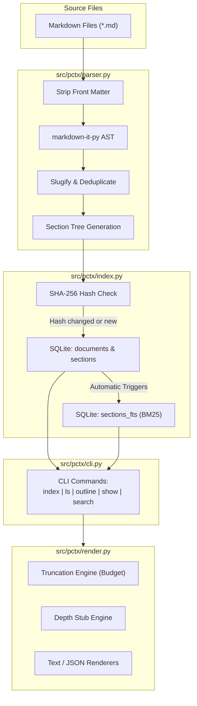

# PCTX Architecture

`pctx` is a local-first Python CLI tool designed to index Markdown documentation into an embedded SQLite database with full-text search (FTS5) and provide hierarchical, token-aware section retrieval for AI coding agents and developers.

---

## Code Tree & File Manifest

```
pctx/
├── pyproject.toml              # Build config, dependencies, Hatchling wheel settings
├── README.md                   # User guide, feature highlights, and CLI quick start
├── AGENTS.md                   # AI agent instructions, 5-step workflow, address conventions
├── CHANGELOG.md                # Release history and version migration notes
├── docs/                       # Architectural and component documentation
│   ├── architecture.md         # System design overview and component layout (this file)
│   ├── models.md               # Core data structures (Document, Section)
│   ├── parser.md               # Markdown tokenization, slugification, address hierarchy
│   ├── index.md                # SQLite storage, FTS5 triggers, incremental hash checks
│   ├── render.md               # Plain text & JSON formatting, truncation, depth stubs
│   └── cli.md                  # CLI argument parsing, subcommands, exit code contract
├── src/
│   └── pctx/
│       ├── __init__.py         # Package version export (__version__ = "0.1.0")
│       ├── models.py           # Shared Document and Section dataclasses
│       ├── parser.py           # markdown-it-py tokenization and Section tree builder
│       ├── index.py            # SQLite schema, transaction management, FTS5 queries
│       ├── render.py           # Presentation layer (Text / JSON formatting, truncation)
│       └── cli.py              # Command-line interface and subcommand dispatch
└── tests/
    ├── fixtures/               # Test markdown documents (ATX, Setext, duplicate headings, etc.)
    ├── test_parser.py          # Unit tests for tokenization, headings, line ranges, addresses
    ├── test_index.py           # Unit tests for database lifecycle, migrations, cascading deletes
    ├── test_render.py          # Unit tests for text formatting, depth filtering, token budgets
    ├── test_cli.py             # End-to-end integration tests for the CLI subcommands
    └── test_search.py          # Tests for BM25 ranking, heading priority, query sanitization
```

### What's What in Each File

| Component File | Role & Core Responsibility |
|---|---|
| [`src/pctx/models.py`](file:///c:/Users/nshri/Github/pctx/src/pctx/models.py) | **Domain Models**: Immutable dataclasses (`Document`, `Section`) shared across parser, database, and rendering layers without circular dependencies. |
| [`src/pctx/parser.py`](file:///c:/Users/nshri/Github/pctx/src/pctx/parser.py) | **Markdown Parsing Engine**: Uses `markdown-it-py` to parse CommonMark documents, extract ATX/Setext headings while ignoring code blocks, assign 0-based source line ranges, and generate deterministic hierarchical addresses. |
| [`src/pctx/index.py`](file:///c:/Users/nshri/Github/pctx/src/pctx/index.py) | **Persistence & Search**: Manages `.pctx/index.sqlite` with SQLite WAL mode, foreign keys, SHA-256 change detection, FTS5 virtual tables, automatic triggers, and BM25 ranking. |
| [`src/pctx/render.py`](file:///c:/Users/nshri/Github/pctx/src/pctx/render.py) | **Output & Budget Formatting**: Formats CLI output in compact text or machine-readable JSON. Implements hierarchical truncation (paragraph boundaries) and child section stubs. |
| [`src/pctx/cli.py`](file:///c:/Users/nshri/Github/pctx/src/pctx/cli.py) | **CLI Dispatcher**: Built with `argparse`. Exposes five subcommands (`index`, `ls`, `outline`, `show`, `search`), routes diagnostic output to `stderr`, and handles directory traversal to find the nearest index. |

---

## Architectural Data Flow



---

## Core System Invariants & Design Principles

### 1. Zero Cloud & Deterministic Addressing
`pctx` relies strictly on standard Python libraries plus CommonMark parsing (`markdown-it-py`). Section addresses follow strict rules:
- Headings are lowercased and stripped of Markdown formatting and punctuation.
- Hierarchies are joined with `/`: `architecture.md#design/components`.
- Duplicate headings within the same parent receive sequential suffixes: `architecture.md#design/components-2`.
- The root document address is the file path itself: `architecture.md`.

### 2. Context Window Economy (Tokens First)
Rather than dumping entire files into an LLM context, `pctx` acts as an information retrieval buffer:
- Token counts are calculated uniformly: $\max(1, \lfloor \text{bytes} / 4 \rfloor)$.
- Retrieving sections with `--depth` renders lower-level subheadings as short stubs rather than full text.
- Enforcing `--max-tokens` cleanly breaks on paragraph boundaries, leaving an explicit continuation marker:
  ```
  [TRUNCATED]
  Continue from: docs/guide.md#installation/docker
  ```

### 3. Content-Addressed Incremental Indexing
Re-indexing a repository of thousands of documents does not re-parse unchanged files:
- Each indexed file is fingerprinted using a SHA-256 hash.
- Unchanged files are skipped with zero database writes.
- Modified files are updated within a single atomic transaction: the previous document record is deleted (triggering SQLite foreign key cascade deletion for sections and full-text indexes), followed by fresh insertion.
- Deleted files from disk are purged from the SQLite index during directory traversal.

---

## Detailed Component Documentation

For deep-dive documentation on each individual module:

- [Models Architecture (`src/pctx/models.py`)](file:///c:/Users/nshri/Github/pctx/docs/models.md)
- [Parser Implementation (`src/pctx/parser.py`)](file:///c:/Users/nshri/Github/pctx/docs/parser.md)
- [Index & Storage Engine (`src/pctx/index.py`)](file:///c:/Users/nshri/Github/pctx/docs/index.md)
- [Renderer & Truncation Layer (`src/pctx/render.py`)](file:///c:/Users/nshri/Github/pctx/docs/render.md)
- [CLI Dispatcher (`src/pctx/cli.py`)](file:///c:/Users/nshri/Github/pctx/docs/cli.md)
