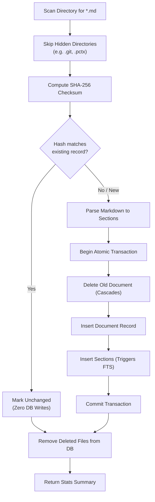

# PCTX Index & Storage Engine (`src/pctx/index.py`)

[`src/pctx/index.py`](file:///c:/Users/nshri/Github/pctx/src/pctx/index.py) manages persistent SQLite storage and full-text search (FTS5) for indexed documentation repositories.

---

## Why SQLite + FTS5?

For local-first CLI tools:
1. **Zero External Services**: SQLite requires no background daemon, Docker container, or credentials. The entire database resides in a single file: `.pctx/index.sqlite`.
2. **ACID Transactions**: Atomic updates ensure that indexing interrupts or parsing failures never corrupt the index state.
3. **High-Performance Full-Text Search**: SQLite's built-in FTS5 module delivers sub-millisecond keyword queries with native BM25 ranking and snippet generation.
4. **Relational Constraints**: Foreign key cascading ensures that deleting a document automatically cleans up all associated sections and full-text index records.

---

## Database Schema

```sql
PRAGMA foreign_keys = ON;
PRAGMA journal_mode = WAL;

-- 1. Document metadata and incremental change detection
CREATE TABLE IF NOT EXISTS documents (
    id INTEGER PRIMARY KEY,
    path TEXT NOT NULL UNIQUE,      -- Relative path from index root (forward slashes)
    root TEXT NOT NULL,              -- Absolute path of index root
    content_hash TEXT NOT NULL,      -- SHA-256 digest of file content
    summary TEXT,                    -- Extracted L0 document summary
    indexed_at TEXT NOT NULL         -- ISO 8601 UTC timestamp
);

-- 2. Section hierarchy and content storage
CREATE TABLE IF NOT EXISTS sections (
    id INTEGER PRIMARY KEY,
    doc_id INTEGER NOT NULL,
    parent_id INTEGER,
    address TEXT NOT NULL UNIQUE,   -- Stable section address (e.g. "doc.md#intro/setup")
    heading TEXT,
    slug TEXT NOT NULL,
    level INTEGER NOT NULL,
    start_line INTEGER NOT NULL,
    end_line INTEGER NOT NULL,
    estimated_tokens INTEGER NOT NULL,
    content TEXT NOT NULL,
    FOREIGN KEY(doc_id) REFERENCES documents(id) ON DELETE CASCADE,
    FOREIGN KEY(parent_id) REFERENCES sections(id) ON DELETE CASCADE
);

-- 3. Full-Text Search Virtual Table (FTS5)
CREATE VIRTUAL TABLE IF NOT EXISTS sections_fts USING fts5(
    address UNINDEXED,              -- Address stored for lookup without indexing
    heading,                        -- Heading text (heavily weighted)
    content                         -- Markdown body text
);
```

### Automatic FTS Synchronization Triggers

Rather than maintaining FTS records manually in Python code, `index.py` defines SQL triggers that keep `sections_fts` automatically in sync with the relational `sections` table:

```sql
CREATE TRIGGER IF NOT EXISTS sections_fts_ai AFTER INSERT ON sections BEGIN
    INSERT INTO sections_fts(rowid, address, heading, content)
    VALUES (new.id, new.address, coalesce(new.heading, ''), new.content);
END;

CREATE TRIGGER IF NOT EXISTS sections_fts_ad AFTER DELETE ON sections BEGIN
    DELETE FROM sections_fts WHERE rowid = old.id;
END;

CREATE TRIGGER IF NOT EXISTS sections_fts_au AFTER UPDATE ON sections BEGIN
    DELETE FROM sections_fts WHERE rowid = old.id;
    INSERT INTO sections_fts(rowid, address, heading, content)
    VALUES (new.id, new.address, coalesce(new.heading, ''), new.content);
END;
```

When a document is deleted:
1. `DELETE FROM documents WHERE id = ?` executes.
2. SQLite's `ON DELETE CASCADE` deletes all rows in `sections` belonging to that `doc_id`.
3. The `sections_fts_ad` trigger fires for each deleted section, removing entries from `sections_fts`.

---

## Incremental Indexing Engine

The `index_directory` method maintains the index incrementally:



### Safety Guarantees:
- **Parse-First**: The file is completely parsed *before* opening the SQL transaction. If a file contains syntax errors or crashes the parser, the transaction never starts, leaving the previous database state intact.
- **Atomic Upsert**: Modifying a file replaces the document and all its sections within a single transaction.

---

## Full-Text Search Implementation

The `search` method runs keyword queries against `sections_fts`:

```python
def search(self, query: str, limit: int = 20) -> list[dict]:
```

### 1. Query Sanitization
FTS5 has strict query syntax rules. Unescaped quotes, parentheses, or operators like `AND`, `OR`, `NOT`, and `*` can cause `sqlite3.OperationalError`.
`index.py` isolates alphanumeric terms, strips special characters, and wraps individual terms in double quotes joined by `AND`:
```python
clean_terms = [
    f'"{clean_term}"'
    for term in query.strip().split()
    if (clean_term := "".join(c for c in term if c.isalnum() or c in ("-", "_")))
]
fts_query = " AND ".join(clean_terms)
```

### 2. BM25 Heading Weighting
Headings are 10x more relevant than body text when searching for topics:
```sql
SELECT address, heading,
       snippet(sections_fts, -1, '<b>', '</b>', '...', 20) AS snippet,
       bm25(sections_fts, 0.0, 10.0, 1.0) AS score
FROM sections_fts
WHERE sections_fts MATCH ?
ORDER BY score
LIMIT ?
```
- Column 0 (`address`): weight `0.0` (unindexed).
- Column 1 (`heading`): weight `10.0` (heavily boosted).
- Column 2 (`content`): weight `1.0` (standard relevance).
- `snippet(..., -1, ...)` automatically identifies and extracts the matching column with contextual highlight tags `<b>...</b>`.

---

## Index Discovery (`Index.find`)

When running retrieval commands (`pctx ls`, `pctx show`), users should not have to manually specify the path to `.pctx/index.sqlite`.

`Index.find(start_dir)` starts at the current working directory (or `start_dir`) and walks upwards towards the filesystem root:
```python
current = start
while True:
    candidate = current / ".pctx" / "index.sqlite"
    if candidate.is_file():
        return cls(candidate)
    parent = current.parent
    if parent == current:
        break
    current = parent
raise IndexNotFoundError(...)
```
If no index is found anywhere in the ancestor chain, an actionable error message is raised.
