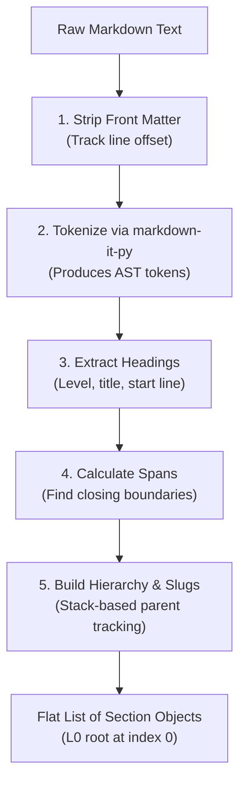

# PCTX Parser Engine (`src/pctx/parser.py`)

[`src/pctx/parser.py`](file:///c:/Users/nshri/Github/pctx/src/pctx/parser.py) is the core parsing engine of `pctx`. It converts raw Markdown documents into structured, depth-first ordered lists of `Section` objects with stable hierarchical addresses.

---

## Why markdown-it-py Over Regular Expressions?

Naive Markdown parsers often use regular expressions like `r"^#{1,6}\s+(.*)$"` to locate headings. This approach fails on several real-world documentation patterns:
1. **Fenced Code Blocks**: Python, Bash, or Ruby code snippets inside markdown often contain `#` comments. A regex parser will misidentify comments inside code blocks as document headings.
2. **Setext Headings**: CommonMark supports underline-style headings:
   ```markdown
   Top Level Heading
   =================
   Sub Heading
   -----------
   ```
   Regex-based parsers fail to associate the underlined text with heading levels.
3. **YAML Front Matter**: Headers like `title: My Doc` or `tags: [foo]` can trigger false matches.

`pctx` uses [`markdown-it-py`](https://github.com/executablebooks/markdown-it-py), a 100% CommonMark-compliant tokenizer that produces a clean token stream, completely isolating code blocks and accurately detecting both ATX (`#`) and Setext headings.

---

## The Parsing Pipeline



---

## Step-by-Step Implementation Details

### 1. Front Matter Stripping (`_strip_frontmatter`)
Detects leading YAML front matter enclosed by `---` delimiters:
```python
def _strip_frontmatter(text: str) -> tuple[str, int]:
```
- Returns `(stripped_text, lines_consumed)`.
- **Critical Design Choice**: Lines consumed by front matter are tracked as an offset (`fm_offset`). When token positions are calculated in the stripped text, `fm_offset` is added back so that all section `start_line` and `end_line` values match the original file on disk byte-for-byte.

### 2. Tokenization & Heading Extraction (`_extract_headings`)
Uses `MarkdownIt().parse(stripped_text)` to extract heading tokens:
- Inspects tokens with `tok.type == "heading_open"`.
- Extracts heading level from `tok.tag` (`h1` $\to$ 1, `h2` $\to$ 2, etc.).
- Line number is taken from `tok.map[0]` (0-based in stripped text).
- Next token of type `inline` provides the raw text title.
- Code blocks (tokens of type `fence` or `code_block`) are skipped entirely, eliminating false positives.

### 3. Slugification & Markdown Stripping (`slugify`)
Transforms heading text into clean URL-compatible slugs:
1. Strips links: `[text](url)` $\to$ `text`.
2. Strips image alt text: `` $\to$ `alt`.
3. Strips formatting characters: `*_`~`.
4. Converts text to lowercase.
5. Removes all punctuation except word characters, whitespace, and hyphens.
6. Replaces whitespace and underscores with hyphens (`-`).
7. Collapses repeated hyphens and trims leading/trailing hyphens.
8. If the resulting slug is empty, falls back to `"section"`.

### 4. Sibling Slug Deduplication (`_resolve_slug`)
Markdown documents often contain duplicate headings (e.g. repeated `## Overview` or `### Examples` under different sections):
- Sibling deduplication is scoped **per parent**.
- The first occurrence uses the bare slug: `overview`.
- Subsequent sibling occurrences receive sequential numeric suffixes: `overview-2`, `overview-3`.

### 5. Content Span Calculation (`Pass 1`)
Determines the line boundaries for every heading:
- A heading starts at its heading line: `start = h.line + fm_offset`.
- It extends downward until the line immediately preceding the next heading of **equal or higher level** (lower numerical level), or reaches the end of the file.
- If an H1 has H2 and H3 child sections, the H1's content span spans the entire subsection block, ensuring parent sections are self-contained.

### 6. Hierarchy & Address Construction (`Pass 2`)
Builds hierarchical addresses using a level stack:
- Level 0 is the root document: `doc_name` (no fragment).
- For heading level $L$, the parser finds the nearest ancestor on the stack where `parent_level < L`.
- Addresses are assembled hierarchically:
  $$\text{address} = \text{doc\_path}\#\text{parent\_fragment}/\text{slug}$$
  Example:
  ```
  architecture.md                 (Level 0)
  architecture.md#design          (Level 1)
  architecture.md#design/storage  (Level 2)
  ```

---

## Token Estimation (`estimate_tokens`)

`pctx` avoids heavy runtime dependencies like `tiktoken` or `transformers` by using a deterministic, fast UTF-8 byte approximation:

```python
def estimate_tokens(text: str) -> int:
    return max(1, len(text.encode("utf-8")) // 4)
```

- Guaranteed consistent across indexing and retrieval.
- Works across all human languages and UTF-8 multibyte characters.
- Evaluates empty strings safely as `1` token.

---

## Public Functions

| Function | Signature | Description |
|---|---|---|
| `parse_text` | `(text: str, doc_path: str = "test.md") -> list[Section]` | Parses in-memory Markdown string into a list of `Section` objects. Index 0 is always the Level 0 document root. |
| `parse_file` | `(path: str) -> list[Section]` | Reads a file from disk with UTF-8 encoding and passes it to `parse_text` with the file's basename as `doc_path`. |
| `slugify` | `(text: str) -> str` | Converts arbitrary heading text to a sanitized slug. |
| `estimate_tokens` | `(text: str) -> int` | Computes token count for text. |
