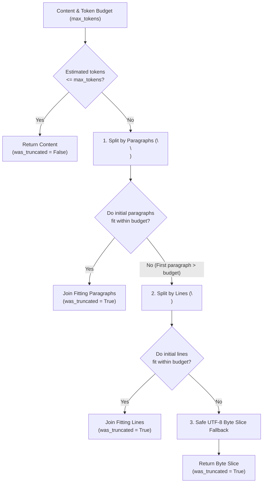

# PCTX Render & Formatting Engine (`src/pctx/render.py`)

[`src/pctx/render.py`](file:///c:/Users/nshri/Github/pctx/src/pctx/render.py) is the presentation layer for `pctx`. It converts domain models (`Document`, `Section`) and query results into formatted output for human developers (plain text) and AI coding agents (JSON).

---

## Why Separate Rendering From CLI Dispatch?

1. **Testability Without Subprocesses**: Formatting logic, depth filtering, and paragraph truncation can be tested thoroughly via fast unit tests without launching CLI subprocesses or opening databases.
2. **Dual-Format Parity**: Ensures that every piece of information available in text mode is also cleanly exposed in machine-readable JSON mode.
3. **Token Budget Enforcement**: Centralizes token truncation and continuation address logic in a single reusable engine.

---

## The Truncation Engine (`truncate_content`)

When an AI agent requests a section with `--max-tokens N`, returning raw sliced text would break code blocks, cut sentences in half, and introduce syntax errors.

`pctx` implements a **hierarchical truncation policy**:



### Continuation Marker Guarantee
Whenever `was_truncated` is `True`, `render_show_text` appends an explicit continuation notice:
```markdown
[TRUNCATED]
Continue from: docs/architecture.md#design/components
```
This informs the agent that more content exists and provides the exact address to request next.

---

## Child Section Stubs (`--depth`)

Large sections often contain several nested subsections that would unnecessarily consume context window tokens.

When `--depth N` is passed to `pctx show`:
1. The engine calculates the relative depth of each descendant section:
   $$\text{rel\_depth} = \text{child.level} - \text{section.level}$$
2. The content is sliced at the start line of the first section with $\text{rel\_depth} > \text{depth}$.
3. Subsections at relative depth $\text{depth} + 1$ are rendered as **child stubs**:
   ```
   Sub-sections:
     → doc.md#intro/setup     Setup            (~25 tokens)
     → doc.md#intro/prereqs   Prerequisites    (~15 tokens)
   ```

Agents can view the top-level section text and selectively expand only the child stubs they need.

---

## Output Formats & Schemas

### 1. `ls` (Document Listing)

**Text Format**:
```
AGENTS.md (~753 tokens)  AGENTS.md
README.md (~1178 tokens)  pctx
docs/architecture.md (~650 tokens)  PCTX Architecture
```

**JSON Format (`--json`)**:
```json
[
  {
    "path": "docs/architecture.md",
    "summary": "PCTX Architecture",
    "estimated_tokens": 650
  }
]
```

### 2. `outline` (Heading Hierarchy)

**Text Format**:
```
# pctx  [README.md#pctx]  (~1178 tokens)
  ## Features  [README.md#pctx/features]  (~213 tokens)
  ## Installation  [README.md#pctx/installation]  (~31 tokens)
  ## Quick Start  [README.md#pctx/quick-start]  (~130 tokens)
```

**JSON Format (`--json`)**:
```json
[
  {
    "address": "README.md#pctx/features",
    "heading": "Features",
    "level": 2,
    "estimated_tokens": 213,
    "start_line": 15,
    "end_line": 28
  }
]
```

### 3. `show` (Section Content)

**JSON Format (`--json`)**:
```json
{
  "address": "docs/guide.md#installation",
  "heading": "Installation",
  "level": 2,
  "estimated_tokens": 42,
  "content": "## Installation\n\n```bash\npip install -e .\n```",
  "truncated": false,
  "continuation_address": null,
  "stubs": []
}
```

If truncated:
```json
{
  "truncated": true,
  "continuation_address": "docs/guide.md#installation/docker",
  ...
}
```

### 4. `search` (Full-Text Search)

**Text Format**:
```
README.md#pctx/features  Features
  - **Local-first & Zero Cloud Dependencies**: Stores everything locally in `.pctx/index.<b>sqlite</b>`.
```

**JSON Format (`--json`)**:
```json
[
  {
    "address": "README.md#pctx/features",
    "heading": "Features",
    "snippet": "- **Local-first & Zero Cloud Dependencies**: Stores everything locally in `.pctx/index.<b>sqlite</b>`.",
    "score": -4.2185
  }
]
```
